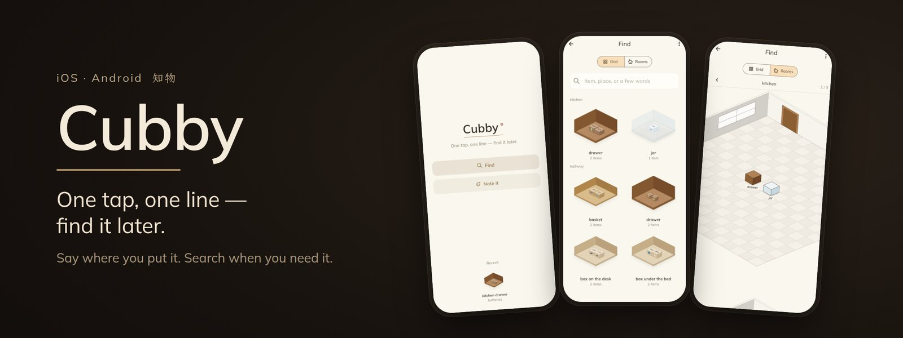

# Building Cubby: One Line Now, Find It Later

I'm zosc, and Cubby is the iOS and Android app I've been building for one job: remembering where you put things. Its tagline is the whole product — *one tap, one line, find it later.*

## The problem is small and stubborn

The things I lose are never the ones I use every day. It's the spare key, the passport, the warranty card, the winter blankets — things I put somewhere sensible and then don't touch for months.

The usual answer is a home inventory app, and that's exactly what people don't keep up with: you build rooms and categories before writing a single note, and after a week it's one more database to maintain.

So the brief I wrote for myself was narrow:

- Note it in one sentence. No forms, no fields, no setting up rooms first.
- Find it later by searching a word.
- The core action should take about ten seconds.

It is deliberately **not** an inventory, asset or storage-planning tool. No prices, no warranties, no barcodes, no team sharing.

## The sentence is the source of truth

You type or dictate something like "spare key in the hallway drawer" and tap once. Cubby works out the item and the place on its own — the parser is rule-based and handles English and Chinese — and files it into a little box.

The decision that shaped everything after it: **the original sentence is always saved exactly as you said it, and everything structured — item, container, room — is derived data that can be rebuilt.** If parsing fails, the note is still saved and still searchable. Whenever I later had to decide whether some feature was allowed to overwrite something, this rule usually answered it.

Voice input is just the system keyboard's dictation. I didn't build a recording screen or a speech pipeline: fewer permissions, fewer error states, and typing always works. The iPhone Siri shortcut ("Note it in Cubby") follows the same idea — the native side only appends your words, untouched, to a small inbox file, and the app parses them the next time it opens. The tricky bit was clearing the inbox: read-then-delete loses any sentence Siri appends in between, so the app renames the file first and reads the renamed copy.

## Boxes, drawn in code

A list of text worked, but nobody wants to open it. So places show up as little isometric boxes grouped by room, and there's a room view where those boxes stand on a floor you can arrange.

The container's shape comes from your own words: drawer, cabinet, shelf, jar, basket, hook or box. "The second drawer" draws a chest with the middle drawer pulled out. If Cubby can't tell, you get a plain cardboard box. Every visual is drawn in code by one parameterised painter rather than image assets — the app icon is rendered by the same painter, so the colours can't drift between the icon and the app.

One principle kept coming back here: **a wrong guess is worse than no guess.** Items get a small emoji on top when Cubby recognises the name. If the emoji is wrong, you'll think you misremembered what you stored. So the word list is narrow on purpose — "warranty card" is in, a bare "card" isn't, otherwise a warranty card would land next to bank cards. English matches whole words, so "can" doesn't fire on "candle" and "pen" doesn't fire on "open". Furniture in the room view follows the same rule: draw it only when it's recognised. A missing landmark costs nothing; a wrong one sends you to the wrong room.

## Things move

The first versions treated every note as permanent truth. Say "keys in the hallway drawer", later say "keys are in the study cabinet now", and a search for "keys" showed two places. There was simply no idea of "things move" in the model.

The fix borrows from a ledger: for items with the same name, the newest note wins and older ones become history. Nothing is deleted. It only matches exact names — "charger" and "iPad charger" stay two things, because merging the wrong pair is worse than not merging.

Moving something is a new event, not an edit. My first "Move to…" removed the item from the original note, and a widget test immediately showed the consequence: the hallway drawer no longer had any trace of the keys, so the "moved away" list was always empty. If you go back to the drawer to look, the answer should be waiting there. Now the original note stays untouched, the drawer says where the keys went, and there's a "move back" button.

## Bugs that only real phones found

**The widget that crashed on open.** I added a popular package to make home-screen widgets. On a Samsung phone the app crashed as soon as it opened. Bisecting showed the crash was inside a library that package pulled in, not in my code, and v0.1.9 removed it. The Android widget was later rebuilt with the oldest, plainest API (`AppWidgetProvider` and `RemoteViews`), and the whole build step is wrapped so a failure shows an empty widget instead of a "can't load widget" error in the launcher.

**Sounds picked by measuring them.** I wanted the cosy, tactile feel of the game *Unpacking*, but using that game's sounds was off the table: they're copyrighted. Cubby ships five CC0 tracks from Freesound instead. The machine I was working on had no sound card, so I ranked candidates by their envelope and spectrum, then checked each one's meaning. That's how a search for "basket" turned up a basketball bounce, which got thrown out. I trimmed up to 429 ms of silence from the start so the sound lands on the contact frame, and kept only the first hit — one action, one sound.

**Screenshots with empty squares.** Flutter's test renderer doesn't load real fonts, including the icon font. Missing icons draw as empty boxes and the test still passes. The first batch of store screenshots I uploaded had three toolbar icons rendered as squares. Font loading in tests now throws if a font is missing.

**A shop with no products.** The purchase shelf used to appear based on a switch in the code. When I checked, the store had no products set up yet, so a release would have shown a shelf with blank prices and buttons that couldn't buy anything. App Review guideline 2.1(b) rejects exactly that. Now the shelf shows only products the store has actually returned a price for. Without products, the app looks like a plain free app.

## What's for sale, and what never will be

Noting, search, containers, rooms, arranging and sounds are free and never locked. Four materials — cardboard, wood, wicker and glass — are always free.

The rule for adding materials came from a near-mistake: **if a material can be derived from your words, it has to be free.** If you say "passport in the glass jar", Cubby should draw a glass jar. Charging for glass would mean either drawing the wrong thing or putting a paywall in front of a sentence. So the only things for sale are looks no sentence would produce — lacquer, celadon, ebony and brass, plus a Night Lamp look on some platforms. Each is a one-time purchase, not a subscription.

On privacy: there's no account, no server, no ads and no analytics, and Cubby's own code makes no network requests. The store's billing component does check prices and past purchases when the app opens, and on Android, Google Play's billing library sends its own diagnostics to Google. Cubby's privacy policy spells this out. Exported backups never include purchases, since a backup file can be passed around.

## Why Flutter

Cubby started as a native SwiftUI app for iPhone only. When the goal became iOS *and* Android, I switched to a single Flutter codebase and kept the Swift version as a read-only reference. I gave up a sliver of native feel; in return one person can maintain both platforms, and motion matches frame for frame because Flutter draws everything itself. Widgets and Siri are still small native pieces.

## Try it

- [Cubby on zosc.com](https://zosc.com/project/cubby/)
- [App Store](https://apps.apple.com/app/id6804703410)
- [Google Play](https://play.google.com/store/apps/details?id=com.zerblion.findly)
