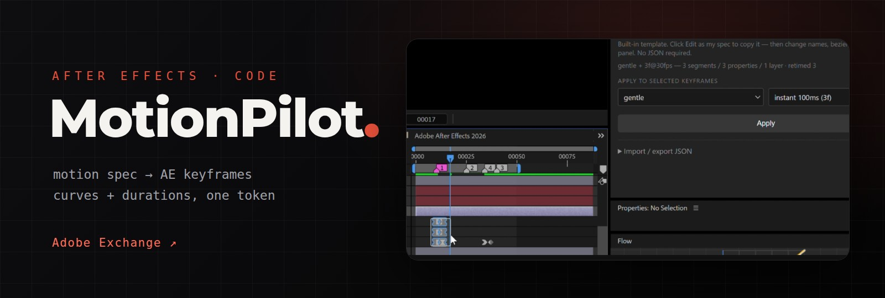

# MotionPilot: An Easing Curve and a Duration Are One Token



I'm zosc, and MotionPilot is my After Effects panel for applying a motion spec where animation is actually made. It's free on Adobe Exchange.

An [earlier post](/posts/2026-07-16-motionhub/) covered the whole MotionRules toolset. This one stays on a single idea inside MotionPilot: **an easing curve and a duration are one decision, so the panel applies them as one token.**

## A curve without a duration is half a rule

Most easing tools give you curves. You pick "ease out", the handles change, and the timing is still whatever you happened to drag. But a real motion spec doesn't say "use this curve"; it says "this kind of movement uses this curve *for this long*." In a spec, `gentle` and `250ms` are one decision, not two.

So the spec MotionPilot reads, `motion-tokens.json`, keeps it small. A motion is three things: which property moves, which curve it follows, and how long it takes. The file pins down the allowed values. Here's a trimmed example from the schema docs:

```json
{
  "curves": [
    { "name": "easeStandard",   "bezier": [0.40, 0.00, 0.20, 1.00] },
    { "name": "easeEmphasized", "bezier": [0.20, 0.00, 0.00, 1.00] },
    { "name": "springSnappy",   "bezier": [0.30, 1.30, 0.50, 1.00] }
  ],
  "durations": { "instant": 100, "fast": 150, "base": 250, "slow": 400 }
}
```

There is no separate "overshoot" field. A bounce lives in the curve itself: when the bezier's y goes above 1 (like `springSnappy`), it overshoots. Fewer fields means fewer ways for two people to describe the same motion differently.

## What Apply Spec does

In the Spec tab you select two or more keyframes, pick a curve and a duration, and click Apply. It works offline, with no account, no API key and no network request. Under the hood it runs five steps, in this order.

**1. Find every selected keyframe, on every layer.** When you box-select keyframes across several layers, After Effects often reports only the current layer through `selectedLayers` and `selectedProperties`. So the panel walks every layer's property tree and collects every property with at least two selected keys. Each adjacent pair of selected keys is one segment.

**2. Retime first, then ease.** The handle speed depends on how long the segment is, so doing it the other way round gives the wrong speeds. The first key stays put, and each following key moves to the previous one plus the duration tier, snapped to a whole frame. 250 ms is 7.5 frames at 30 fps and 15 frames at 60 fps, so the panel rounds to whole frames and shows you the frame count next to the tier. With a curve-only tool, that's arithmetic you do in your head.

**3. Move keyframes the hard way.** After Effects has no "move keyframe" call in its scripting API. Moving one means reading everything about it, deleting it, recreating it at the new time and restoring it: value, incoming and outgoing ease, interpolation type, and for position the spatial tangents and roving flag too. If you forget the tangents, the motion path quietly changes shape.

**4. Refuse half-edits.** If retiming would push the last selected key into an unselected keyframe after it, that whole property is skipped and reported, not partly changed. I'd rather do nothing than leave a project half-modified.

**5. Write the handles.** Handles only apply under Bezier interpolation, so linear or hold segments are converted first. The other side of each key is left as it was. The whole run is one undo group, so one Ctrl+Z puts everything back.

## Turning a cubic-bezier into AE handles

After Effects doesn't take a cubic-bezier directly. Its ease handles are a speed and an influence per keyframe. The conversion at the heart of the panel is:

- outgoing handle of the first key: influence = x1 × 100%, speed = (y1 / x1) × the segment's average speed
- incoming handle of the second key: influence = (1 − x2) × 100%, speed = ((1 − y2) / (1 − x2)) × the average speed

When y is outside 0–1 you get overshoot, and the handles express that too, still with just two keyframes.

The firm rule is **never bake frame by frame**. An early version sampled curves into one keyframe per frame. One test produced 544 commands and took about 36 seconds to run in AE. Switching to bezier handles cut it to a few dozen. Motions with several bounces (elastic, bounce) become a few control keyframes, each segment with its own handles. That's still nothing like one key per frame.

One pitfall cost me the overshoot for a while. Adding a keyframe resets the automatic handles of its neighbour, which wiped the outgoing handle I had just set on the first key. The springy curve came out flat. The fix is boring: create both keys with their handles, then set the first key's outgoing handle once more.

## Where the AI part fits

MotionPilot can also build motion from a sentence, and that part is optional. You bring your own AI: a signed-in OpenAI Codex CLI, your own OpenAI or Google Gemini API key, or a local endpoint such as Ollama. There's no hosted AI service.

The token idea is what keeps that half honest. **The model never writes easing values.** It names a curve from your spec, and the panel compiles that name into real handles. Even when the model writes ExtendScript directly, easing must go through the panel's own helper, with curves from the current spec; left to fill in speed and influence, a model invents its own handles.

I'm careful with the claim: I don't say every generated scene is fully spec-compliant. What I can say precisely is that the model doesn't compute easing; it picks from your list.

## One spec file, shared with MotionRules

MotionPilot is the "build" step of MotionRules. MotionSpec is where you define the curves and duration tiers. MotionPilot applies them in After Effects. MotionSheet audits a Lottie export against the same `motion-tokens.json`. Because all three read the same file, the spec, the AE work and the developer handoff can't drift apart.

The spec loads from a URL. By default that's [motionrules.com/spec](https://motionrules.com/spec/), whose spec is published under CC BY 4.0. A studio publishes once and every artist's panel picks up the change. One index can list several targets — for example a phone UI profile and a head-mounted display profile with different timing budgets — and the panel refuses a spec whose target doesn't match the one you chose. A file you place locally always beats the URL.

The pitfall here was silent. The panel ships an offline fallback copy of the spec. For a while that copy was still the first version: curve names that no longer existed, and a `slow` tier of 400 ms instead of 350. The prompt builder used it to tell the model which curve names were allowed, so offline, every generated motion was off-spec and nothing reported an error. The fallbacks are now generated from the spec, never copied by hand.

## Two more After Effects surprises

- **Non-English layer names produced empty files.** The panel passes larger results through a file, and ExtendScript's `File.write` fails on non-ASCII text, leaving a 0-byte file. Comps with Chinese layer names broke every time with a vague "unexpected end of JSON". The old panel had already fixed this by escaping text to `\uXXXX`; I left that fix behind when I moved to the new CEP panel. Lesson: when you port code, port its old patches too.
- **"The AI is slow" was the network.** A prompt asking for a one-word reply took about 116 seconds at the default reasoning level and 115 at low. The same time at both levels meant the model wasn't the problem. The API host wasn't reachable directly, and the CLI kept retrying until it timed out. After Effects started from the Start menu doesn't inherit a user's proxy environment variables. With a proxy set explicitly, the same prompt took 5.5 seconds. The panel now manages the proxy itself, and never sends local endpoints like Ollama through it.

## Requirements and links

MotionPilot needs After Effects 26.0–26.9. It's developed and tested on Windows; macOS is not verified yet.

- [MotionPilot on zosc.com](https://zosc.com/project/motionpilot/)
- [Adobe Exchange](https://exchange.adobe.com/apps/cc/205857)
- [Demo and guide on motionrules.com](https://motionrules.com/pilot)
