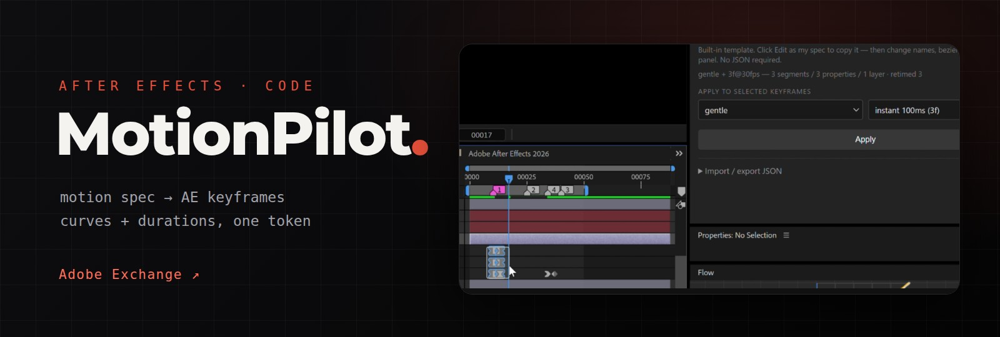

# MotionPilot：缓动曲线和时长，是同一个 token



我是 zosc。MotionPilot 是我做的 After Effects 面板，用来把动效规范直接用在做动画的地方，在 Adobe Exchange 上免费。

[之前那篇](/posts/2026-07-16-motionhub/zh/)讲的是 MotionRules 三件工具的整体，这篇只钻 MotionPilot 里的一个点：**缓动曲线和时长是同一个决定，所以面板把它们当成一个 token 一起套。** 下面讲为什么这么设计、点 Apply Spec 之后关键帧到底经历了什么，以及为此绕过的几处 AE 脾气。

## 只有曲线，规范只说了一半

大多数缓动工具给你的是曲线：选个 ease out，手柄变了，时长还是你当时随手拖出来的那么长。可真正的动效规范从来不说「用这条曲线」，它说的是「这一类动作用这条曲线、走这么久」。在规范里，`gentle` 和 `250ms` 是一个决定，不是两个。

所以 MotionPilot 读的那份 `motion-tokens.json` 很克制：一个动效就三件事——动哪个属性、走哪条曲线、走多久，规范把这三样的允许值定死。下面摘自 motionrules.com 上公开的那份规范（有删减）：

```json
{
  "curves": [
    { "name": "standard", "bezier": [0.25, 0.10, 0.25, 1.00] },
    { "name": "gentle",   "bezier": [0.66, 0.00, 0.34, 1.00] },
    { "name": "bounce",   "bezier": [0.20, 1.00, 0.30, 1.15] }
  ],
  "durations": { "instant": 100, "fast": 150, "base": 250, "slow": 350 }
}
```

里面没有单独的「过冲」字段。弹不弹写在曲线里：贝塞尔的 y 甩到 1 以上（比如 `bounce`），就是过冲。字段越少，两个人把同一个动效写成两种样子的机会就越少。

## Apply Spec 做了什么

在 Spec 页选中两个以上的关键帧，挑一条曲线、一档时长，点 Apply。全程离线，不要账号、不要 API key、不发任何网络请求。但它做的远不止「改一下手柄」，而且顺序是讲究过的。

**一、把所有选中的关键帧都找出来，跨图层也算。** 在时间轴上跨好几层框选关键帧时，AE 的 `selectedLayers` / `selectedProperties` 经常只回报当前那一层。所以面板会把合成里每一层的属性树都走一遍，凡是选中了两个以上关键帧的属性都收进来；同一属性上相邻的两个选中帧，就是一段。

**二、先重定时，再套缓动。** 手柄的速度是按段长算的，顺序反了，速度就是错的。第一个关键帧不动，后面每一帧挪到「前一帧 + 档位时长」，并吸附到整帧。250ms 在 30fps 下是 7.5 帧，在 60fps 下是 15 帧，所以面板会取整到整帧，并在档位旁边直接显示当前帧率下是几帧——只管曲线的工具，这笔账得你自己心算。

**三、用笨办法挪关键帧。** AE 的脚本接口里没有「移动关键帧」。要挪一个，只能把它的一切读出来、删掉、在新时间重建、再一样样还原：数值、进出缓动、插值类型；如果是位置，还有空间切线和 roving。漏了切线，运动路径会悄悄变形。

**四、宁可不做，也不做一半。** 如果重定时会让选区最后一帧撞上后面那个没选中的关键帧，这整个属性就跳过并报出来，而不是改一半留在那儿。

**五、写手柄。** 手柄只在 Bezier 插值下生效，所以 linear / hold 的段先转成 Bezier；每个关键帧的另一侧保持原样。整个过程包在一个撤销组里，Ctrl+Z 一下全部回去。

## 把贝塞尔换算成 AE 手柄

AE 不直接吃 cubic-bezier，它的缓动手柄是每个关键帧上的「速度 + 影响量」。面板最核心的那段换算是：

- 起点的出向手柄：影响量 = x1 × 100%，速度 = (y1 / x1) × 这段的平均速度
- 终点的进向手柄：影响量 = (1 − x2) × 100%，速度 = ((1 − y2) / (1 − x2)) × 平均速度

y 超出 0–1 就是过冲，换算后照样由手柄表达，仍然只有两个关键帧。

硬规矩是**绝不逐帧烤帧**。早期有一版把曲线按帧采样成一帧一个关键帧，实测一次产出 544 条命令，在 AE 里跑了约 36 秒；改用贝塞尔手柄后，命令数砍到几十条。多次振荡的（elastic、bounce）也只是几个控制点关键帧，段与段之间各自带手柄，离「一帧一个」差得远。

有个坑让过冲丢了好一阵：在 AE 里新加一个关键帧，会把相邻关键帧的自动手柄重置掉，刚设好的起点出向手柄就这么被冲没了，弹性曲线出来是平的。修法很朴素：两个关键帧连同各自手柄先建好，最后再把起点的出向手柄补设一次。

## AI 那一半放在哪

MotionPilot 也能用一句话生成动效，但这一半是可选的。AI 自带：登录好的 OpenAI Codex CLI、你自己的 OpenAI 或 Google Gemini API key，或者 Ollama 这类本地端点。没有任何托管的 AI 服务。

让这一半守规矩的，正是 token 这个设计：**模型从不写缓动数值。** 它只从你的规范里点一条曲线的名字，由面板把名字编译成真实的手柄。即使在让模型直接写 ExtendScript 的模式里，缓动也必须走面板自己的函数，曲线数据取自当前规范。要是放任模型自己填速度和影响量，它会给出各种自创手柄，规范存在的意义就没了。

这件事我说得很小心：我不宣称每个生成的场景都百分之百合规。能精确说的是，模型不计算缓动，它只从你的清单里挑。

## 和 MotionRules 共用一份规范

MotionPilot 是 MotionRules 里「做」的那一步：在 MotionSpec 里定义曲线和时长档，在 AE 里用 MotionPilot 套上去，MotionSheet 再拿同一份 `motion-tokens.json` 去走查导出的 Lottie。三者读的是同一个文件，规范、AE 里的活和给开发的交付就不会各说各话。

规范从 URL 加载，默认是 [motionrules.com/spec](https://motionrules.com/spec/)，那份规范以 CC BY 4.0 发布。团队发布一次，每个设计师的面板都会跟上。一个索引可以列出好几个端——比如手机 UI 和头戴显示设备，时长预算各不相同——端对不上的规范，面板直接拒收。本地手放的文件永远压过 URL。

这里踩的是一个不出声的坑。面板内置一份离线兜底规范，给首次安装和断网时用。有一阵子那份兜底还停在第一版：里面的曲线名在现行规范里已经一个都不存在，`slow` 档还是 400ms 而不是 350。它也不是摆设——生成提示词时，正是拿它告诉模型「能用哪些曲线名」。于是一断网，生成的每一条都偏离规范，却没有任何地方报错。现在兜底由规范自动生成，不再手工同步。

## 另外两个 AE 意外

- **中文图层名，写出 0 字节文件。** 面板把较大的结果经文件传回，而 ExtendScript 的 `File.write` 遇到非 ASCII 文本会写失败，留下一个 0 字节的文件。合成里只要有中文图层名就必现，报的是一句费解的「JSON 意外结束」。老面板早就用 `\uXXXX` 转义修过这个问题，我迁到新的 CEP 面板时把这块补丁落下了。教训：搬代码，要连它当年的补丁一起搬。
- **「AI 好慢」其实是网络。** 一句只要求回一个词的提示，默认推理档约 116 秒，低档约 115 秒——两档几乎一样，说明时间根本不在模型身上。真相是那台机器要走代理才连得上 API，而从开始菜单启动的 After Effects 不会继承用户设的代理环境变量，CLI 只能一直重试直连、直到超时。显式配上代理后，同一句只要 5.5 秒。现在由面板自己管理代理，并且绝不让 Ollama 这类本地端点走代理。

## 要求与链接

MotionPilot 需要 After Effects 26.0–26.9，在 Windows 上开发和测试，macOS 尚未验证。

- [MotionPilot 在 zosc.com 的介绍页](https://zosc.com/project/motionpilot/)
- [Adobe Exchange](https://exchange.adobe.com/apps/cc/205857)
- [motionrules.com 上的演示与说明](https://motionrules.com/pilot)
